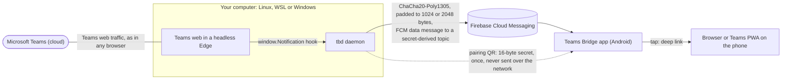

# Teams Bridge (`tbd`)

[](https://github.com/alien2003/teams-bridge/actions/workflows/ci.yml)
[](https://github.com/alien2003/teams-bridge/releases/latest)
[](LICENSE)

Microsoft Teams notifications on an Android phone without the Teams app. `tbd` keeps Teams web open
in a headless Edge/Chromium on your computer, catches every notification Teams raises (by replacing
`window.Notification` in the page, the way Ferdium does), encrypts it and pushes it through Firebase
Cloud Messaging to the **Teams Bridge** app, which shows it and, on tap, opens the chat in the
browser or installed Teams PWA you picked.

**Threat model.** Everything leaves your computer end-to-end encrypted (ChaCha20-Poly1305 with a key
derived from a 16-byte pairing secret that only the computer and the phone hold) and padded to one
of two fixed sizes. Google/FCM sees only ciphertext, its size class, timing, and a topic name that is
derived from the secret and therefore unguessable. Titles, senders, message text and URLs never leave
the daemon in clear text; there is no relay server of ours and no reverse channel. Losing the secret
means pairing again. The protocol is specified in [`proto/PROTOCOL.md`](proto/PROTOCOL.md); what
is in and out of scope, and how to report a vulnerability, in [`SECURITY.md`](SECURITY.md).

Not affiliated with, endorsed or supported by Microsoft. "Microsoft Teams" and "Microsoft Edge" are
trademarks of Microsoft Corporation.

## How it works



The daemon also sends a heartbeat every 6 hours and alerts (session expired, browser dead, daemon
stopping) the same way; nothing ever travels from the phone back to the computer.

## Prerequisites

* **Computer:** Linux (incl. WSL2) or Windows 10/11, with Microsoft Edge or Chromium/Chrome installed.
  `tbd` finds Edge in its standard Windows location and `microsoft-edge`, `chromium`,
  `chromium-browser` or `google-chrome` on Linux; set `browser = "/path"` in `config.toml` otherwise.
* **Firebase project** (free tier is enough):
  1. Create a project at <https://console.firebase.google.com/>.
  2. Add an Android app with package name `io.github.alien2003.teamsbridge`; download its
     `google-services.json` into `android/app/` (needed to build the app).
  3. Cloud Messaging is enabled by default for new projects (*Project settings → Cloud Messaging*:
     "Firebase Cloud Messaging API (V1)" must be *Enabled*).
  4. *Project settings → Service accounts → Generate new private key* → save the JSON next to the
     daemon's config (e.g. `~/.local/share/tbd/fcm.sa.json`, mode 0600) and set
     `fcm_service_account = "fcm.sa.json"` in `config.toml`.
* **Phone:** Android 9 (API 28) or newer with Google Play services.

## Build

Everything is built with [mise](https://mise.jdx.dev/) and stays inside the repository:

```sh
mise trust && mise install
mise run build      # dist/tbd (Linux, static), dist/tbd.exe (Windows), dist/teams-bridge-debug.apk
mise run test       # Go unit + E2E tests against a fake Teams in a real headless Edge, Android JVM tests
```

Without `android/app/google-services.json` the build drops in a placeholder: the APK builds, but push
does not work until you rebuild with your real file.

`mise run release-build` builds what a release publishes into `dist/release/` (signed APK, R8
mapping, both binaries, `SHA256SUMS`); it needs a release key, see
[`docs/DECISIONS.md`](docs/DECISIONS.md) D23 and `scripts/build-release.sh`.

## Install from a release

Every [release](https://github.com/alien2003/teams-bridge/releases) is built by GitHub Actions from
the tagged commit and carries `tbd-linux-amd64`, `tbd-windows-amd64.exe`, `teams-bridge.apk`,
`teams-bridge-mapping.txt.gz` (to read an obfuscated stack trace) and `SHA256SUMS`, each with a
build provenance attestation. The names carry no version, so
`https://github.com/alien2003/teams-bridge/releases/latest/download/<name>` always points at the
newest release. Tags `vX.Y.Z-rc.N` are prereleases; what changed is in [`CHANGELOG.md`](CHANGELOG.md).

**The release APK is built for the maintainer's Firebase project:** it receives only what is sent
with that project's service account. With your own Firebase project (see Prerequisites), take the
`tbd` binary from the release and build the APK yourself with your `google-services.json`.

<a href="https://apps.obtainium.imranr.dev/redirect?r=obtainium://app/%7B%22id%22%3A%22io.github.alien2003.teamsbridge%22%2C%22url%22%3A%22https%3A%2F%2Fgithub.com%2Falien2003%2Fteams-bridge%22%2C%22author%22%3A%22alien2003%22%2C%22name%22%3A%22Teams%20Bridge%22%2C%22preferredApkIndex%22%3A0%2C%22additionalSettings%22%3A%22%7B%5C%22apkFilterRegEx%5C%22%3A%5C%22%5Eteams-bridge%5B.%5Dapk%24%5C%22%2C%5C%22allowedSigningCertHashes%5C%22%3A%5C%2246%3AFC%3AC9%3A4A%3A53%3A66%3A85%3A09%3A66%3A12%3A4F%3A5C%3A30%3AA1%3AA4%3AC6%3A33%3AF0%3A3C%3AA8%3A2E%3A01%3A89%3AC7%3A48%3A63%3A19%3AE1%3ABA%3A16%3AFC%3A3E%5C%22%7D%22%7D"></a>

[Obtainium](https://github.com/ImranR98/Obtainium) keeps the app updated from these releases. The
badge adds it with two settings, which Obtainium shows before it adds anything: *Filter links by
regex* `^teams-bridge[.]apk$` (only the release APK) and *Expected signing certificate hashes* set
to the certificate below, so Obtainium refuses an APK signed by any other key. Use Obtainium 1.7.4
or newer: the check exists since 1.7.0 and works on Android 9 and 10 since 1.7.4. Prereleases are
skipped unless you turn on *Include prereleases*. The badge goes through Obtainium's redirect page
(`apps.obtainium.imranr.dev`, which runs its own analytics); to avoid it, add
`https://github.com/alien2003/teams-bridge` in Obtainium and set the two settings by hand.
`scripts/obtainium-link.sh` generates the link.

Verify what you downloaded (`gh` and `apksigner` are optional; `apksigner` is in the Android SDK's
build-tools):

```sh
sha256sum -c SHA256SUMS --ignore-missing
for f in teams-bridge.apk tbd-linux-amd64; do   # any asset listed in SHA256SUMS
  gh attestation verify "$f" -R alien2003/teams-bridge \
    --signer-workflow alien2003/teams-bridge/.github/workflows/release.yml
done
apksigner verify --print-certs teams-bridge.apk
```

The APK must be signed by exactly this certificate (also in
[`android/release-cert.sha256`](android/release-cert.sha256)):

```
SHA-256 46:FC:C9:4A:53:66:85:09:66:12:4F:5C:30:A1:A4:C6:33:F0:3C:A8:2E:01:89:C7:48:63:19:E1:BA:16:FC:3E
```

On Windows, compare `Get-FileHash tbd-windows-amd64.exe` with `SHA256SUMS`, then
`Unblock-File tbd-windows-amd64.exe`; the binary has no Authenticode signature, so SmartScreen may
warn. Rename it to `tbd.exe` (on Linux: `install -m755 tbd-linux-amd64 ~/.local/bin/tbd`).

**Switching from a self-built debug APK to the release APK** takes one uninstall: Android never
updates an app with one signed by a different key. Uninstall Teams Bridge, install
`teams-bridge.apk`, then run `tbd pair` on the computer and scan the QR code it shows. Plain
`tbd pair` shows the existing pairing (never use `--new` for this: it would unpair every phone), so
the daemon keeps running unchanged. Uninstalling also clears the app's settings: choose **Open
Teams in**, allow notifications and exempt the app from battery optimisation again.

## Set up

Put the binary on your `PATH` (Linux: `install -m755 dist/tbd ~/.local/bin/tbd`; Windows: copy
`dist\tbd.exe` to e.g. `%LOCALAPPDATA%\Programs\tbd\`) and run the commands below from outside the
repository: inside the checkout, mise sets `TBD_HOME` to the development data dir `.local/tbd`.

```sh
tbd login      # a browser window opens with the daemon's own profile: sign in, open Chat, close it
tbd pair       # prints a QR code and the 26-character code, then sends pairing pings
```

Install the app on the phone (`dist/teams-bridge-debug.apk` from your build, or `teams-bridge.apk`
from a release, see above), open **Teams Bridge → Pair**, scan the QR code (or type the code), and
wait for **Paired ✓**. Further down the same screen, under **Open Teams in**, pick where a tap opens
Teams (a browser, or the Teams PWA if you installed one), and allow notifications.

```sh
tbd test-push  # a test notification should arrive on the phone
tbd install    # start the daemon at logon (systemd user unit / Windows scheduled task)
tbd status     # pairing, browser, last heartbeat and last delivered message
```

`tbd install --dry-run` prints exactly what would be written and executed. The daemon sends a
heartbeat every 6 hours; the app warns you if none arrived for 12 hours. If Teams signs you out,
the phone gets a "session expired" alert.

`tbd stop` stops the running daemon, whichever way it was started: it asks it to stop gracefully
(the phone gets a "daemon stopping" alert, the browser closes) and ends it only if it is still
running after 20 s (`--timeout`). `tbd start` starts the installed service again
(`systemctl --user start tbd.service`, or `schtasks /run /tn tbd` on Windows); with a daemon already
running it does nothing. `tbd login` and `tbd pair --new` refuse while the daemon runs, and say so.

### WSL

WSL does not start on its own, and a distribution stops when nothing keeps it running. In WSL,
`tbd install` writes and enables the systemd user unit and prints three steps: run
`loginctl enable-linger` once inside WSL (so the user manager, and tbd, run without a login); register
an unelevated PowerShell logon task on Windows that boots the distribution and runs only
`sleep infinity` (not a second `tbd`, so systemd stays the only supervisor); and, optionally, set
`[general] instanceIdleTimeout=-1` in `%UserProfile%\.wslconfig`, which keeps the distribution (not
just the VM) from idling out. systemd must be enabled in `/etc/wsl.conf` (`[boot] systemd=true`).

### Windows

Use `tbd.exe` natively with the installed Edge; no WSL needed. `tbd install` registers a scheduled
task for your user that starts `tbd.exe run` at logon in a hidden console (`conhost.exe --headless`),
logging to `%LOCALAPPDATA%\tbd\tbd.log`. It needs no administrator rights. The data directory is
`%LOCALAPPDATA%\tbd`; the browser profile inside it is called `tbd`. `tbd stop` / `tbd start` stop
and start it; ending the task (`schtasks /end /tn tbd`, or *End* in Task Scheduler) stops tbd too.

Edge keeps some per-user bookkeeping in the registry no matter which profile it runs
(`HKCU\Software\Microsoft\Edge\…`); for the `tbd` profile that is the key `PreferenceMACs\tbd`.

## Troubleshooting

* **Conditional Access / device compliance.** Tenants that require a compliant or managed device may
  refuse the headless browser (or demand sign-in from a managed browser). `tbd` cannot work around
  that. On an Entra-joined Windows PC, `implicit_signin = true` in `config.toml` lets Edge sign the
  daemon's profile in with the Windows account, which some policies require (it is off by default).
* **Long notifications.** FCM documents a 2048-byte data limit for topic messages; tbd's larger
  padding class is 2769 bytes. FCM accepted such messages when tested (2026-11); should it ever
  reject one, tbd resends it shortened to the smaller class automatically (logged as a warning).
* **"Session expired" alert.** `tbd stop`, then `tbd login` (sign in, close the window), then
  `tbd start`.
* **`tbd login` says "another tbd process is using this data directory (pid N): stop the daemon
  first"** although the Windows task was ended. That is a `tbd.exe` from before `tbd stop` existed:
  its `schtasks /end /tn tbd` ended only the hidden console (`conhost.exe`) and left `tbd.exe`
  running. When upgrading, stop that old daemon *before* copying the new `tbd.exe` over it: the old
  binary on your `PATH` has no `stop` command (it answers `unknown command "stop"`), and Windows
  refuses to overwrite a running exe. Run the new binary from where you built or downloaded it,
  naming the data directory, e.g. `dist\tbd.exe stop --home %LOCALAPPDATA%\tbd`: the old daemon does
  not listen for `tbd stop`, so it waits 20 s and then ends it (no "daemon stopping" alert reaches
  the phone). Ending `tbd.exe` in Task Manager works too. Then copy the new `tbd.exe` into place and
  run `tbd start`. From this version on, ending the task stops tbd as well, and a refusal reads
  "tbd is already running for this data directory (pid N): run `tbd stop`, then this command again".
* **Latency.** FCM topic messages can take from seconds to a few minutes; high priority is requested,
  but battery savers and Doze may still delay them. Exempt Teams Bridge from battery optimisation.
* **Tap opens a browser tab instead of the PWA.** Only Chrome and Edge install a real WebAPK, which
  Android can route links to. Vivaldi, Firefox, Brave and others open a tab instead.
* **A tap opens Teams but not the chat.** Teams' notifications carry no chat id; tbd finds the chat
  in Teams' chat list, which exists only in the **Chat** view. `tbd stop`, `tbd login`, open Chat,
  close the window, `tbd start`. The log line `chat list survey` (no names or text in it) should show
  `conversation_items` above 0. Channel posts open Teams for now, and so does a message whose chat
  the list does not show with that message as its preview (tbd prefers Teams' start page to a
  wrong chat).
* **Nothing arrives.** `tbd status` shows whether notifications are being captured; `tbd run
  --log-level debug` logs their raw structure (including text — debug only). `tbd test-push` checks
  the FCM path on its own.
* **"App not installed" or a package conflict when installing the release APK** over a debug build
  (or the other way round): the keys differ, uninstall first (see *Switching from a self-built debug
  APK* above).
* **Obtainium reports a signing certificate mismatch:** the APK it downloaded is not signed by the
  release key. Do not install it; open an issue (or a private report, if you suspect tampering).
* **Reporting a bug:** paste only info-level log lines (they hold structure, counts and lengths, no
  names or message text; replace your user name in paths), never `--log-level debug` output,
  `config.toml`, the pairing code or a picture of the QR code; see the bug report form.

## Contributing and security

How to build, test and send a change: [`CONTRIBUTING.md`](CONTRIBUTING.md). Report a vulnerability
privately as described in [`SECURITY.md`](SECURITY.md), not in a public issue. Decisions and
measured facts behind the design are in [`docs/DECISIONS.md`](docs/DECISIONS.md).

## License

[WTFPL v2](LICENSE): do what you want with it.
